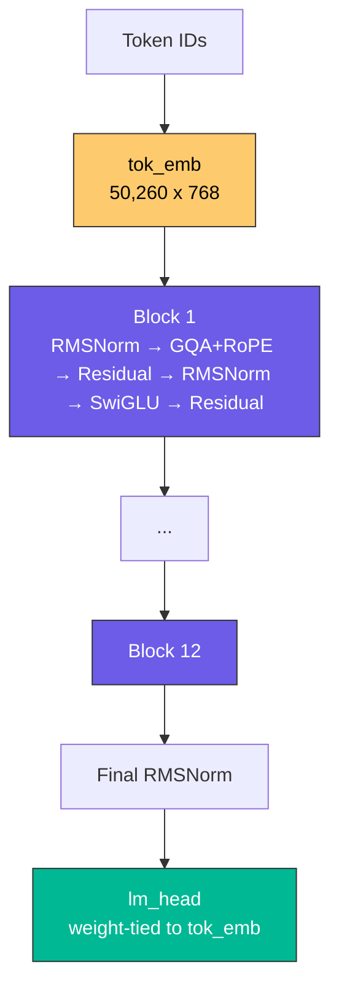
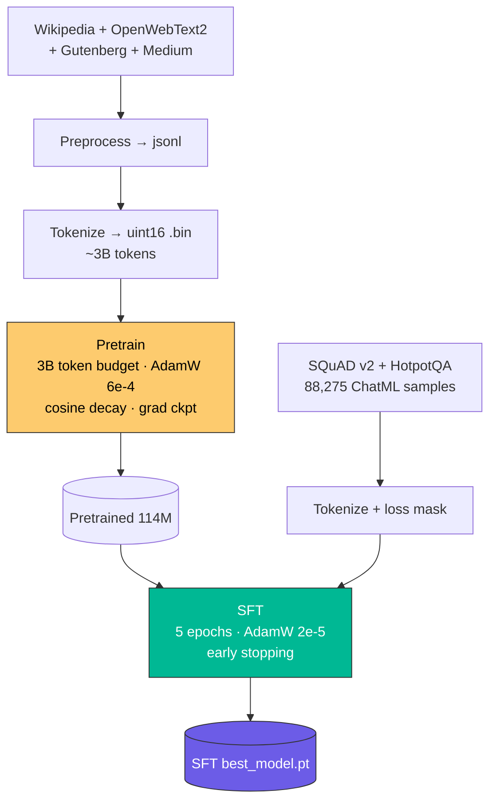
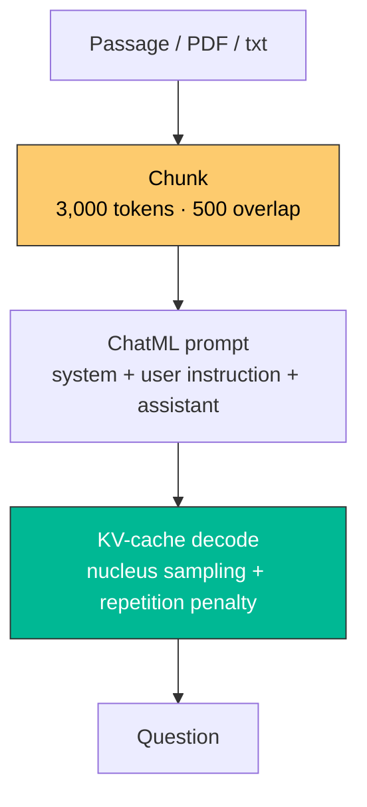

# SLM Question Generator

**A 114.1M-parameter language model trained from scratch — give it a passage, get exam-style questions.**

### Live Demo

| Resource | Link |
|---|---|
| Model (SFT) | [nayan90k/slm-question-gen-sft](https://huggingface.co/nayan90k/slm-question-gen-sft) |
| Model (Pretrained) | [nayan90k/slm-question-gen-pretrained](https://huggingface.co/nayan90k/slm-question-gen-pretrained) |
| Dataset (SFT) | [nayan90k/slm-question-gen-sft-data](https://huggingface.co/datasets/nayan90k/slm-question-gen-sft-data) |
| Dataset (Pretrain) | [nayan90k/slm-question-gen-pretrain-data](https://huggingface.co/datasets/nayan90k/slm-question-gen-pretrain-data) |

---

## What it does

- **Paste a passage** → get a question ready for a quiz or assignment.
- **Two question styles** — short-answer recall, and complex multi-hop reasoning.
- **Full training pipeline included** — corpus download, tokenization, pretraining, SFT, evaluation. No external API model; weights are trained from scratch.
- **Runs on CPU** — inference works without a GPU, so demos and grading setups are cheap.
- **Long documents handled automatically** — PDFs and text are chunked into overlapping windows.

---

## Architecture

### 1. Model — 114.1M Decoder-Only Transformer

GPT-2-style pre-norm transformer with grouped-query attention.



| Property | Value |
|---|---|
| Parameters | 114.1M |
| Layers | 12 |
| Hidden size | 768 |
| Attention | GQA (12 query heads / 4 KV heads, 3:1 ratio) |
| Feed-forward | SwiGLU (ffn_dim 2048) |
| Position encoding | RoPE (theta 10,000) |
| Vocabulary | tiktoken `r50k_base` + 3 special tokens (50,260) |
| Context window | 4,096 tokens |

### 2. Training Pipeline — Pretrain → SFT



### 3. Inference — Chunk → Prompt → Sample



---

## Tech Stack

| Layer | Choice | Why |
|---|---|---|
| Framework | **PyTorch** ≥ 2.3 | Native transformer + KV-cache inference |
| Tokenizer | **tiktoken** `r50k_base` | Fast GPT-4-style BPE, 50,257 tokens |
| Special tokens | `<\|im_start\|>` `<\|im_end\|>` `<\|pad\|>` | ChatML format for instruction tuning |
| Attention | **GQA** 12Q / 4KV | Smaller KV cache, near-MHA quality |
| Activation | **SwiGLU** | Better than GELU at small scale |
| Normalization | **RMSNorm** | Pre-norm, stable in bf16 |
| Optimizer | **AdamW** (fused on CUDA) | Weight decay on 2D+ params only |
| LR schedule | Linear warmup + cosine decay | Standard for 100M-class models |
| Metrics | **BERTScore**, ROUGE-L, BLEU-4, METEOR | Semantic + lexical overlap |

---

## Training Data

| Phase | Source | Size |
|---|---|---|
| Pretrain | Wikipedia, OpenWebText2, Project Gutenberg, Medium | ~3.0B tokens (9,156 steps) |
| SFT | SQuAD v2 (short) + HotpotQA (complex) | 83,861 train / 4,414 val |
| Eval | SQuAD v2 validation | 50 samples per difficulty |

SFT samples are stored in ChatML format:

```
<|im_start|>system
You are an expert educational assessment generator...<|im_end|>
<|im_start|>user
Generate 1 short questions from the following text:

{context}<|im_end|>
<|im_start|>assistant
{output}<|im_end|>
```

---

## Usage

### CLI — Interactive

```bash
python ask.py                          # default: short_answer, temp 0.2
python ask.py --type short_answer
python ask.py --type complex
python ask.py --type short_answer --temp 0 --max_new_tokens 48   # greedy, deterministic
```

### CLI — One-shot (text or file)

```bash
python src/inference/generate.py --input "The mitochondrion is the powerhouse of the cell." --difficulty short

python src/inference/generate.py --input notes.pdf --difficulty complex --n 3
```

| Flag | `ask.py` | `generate.py` |
|---|---|---|
| Question type | `--type short_answer` / `--type complex` | `--difficulty short` / `--complex` |
| Temperature | `--temp 0.2` (0 = greedy) | `--temp 0.7` |
| Top-p | `--top_p 0.9` | `--top_p 0.9` |
| Output length | `--max_new_tokens` | `--max_new_tokens` |
| Count per chunk | — | `--n 1` |
| Checkpoint | `--ckpt path/to/model.pt` | `--ckpt path/to/model.pt` |

### Python API

```python
from src.inference.generate import load_model, generate_from_text

model, enc, device = load_model()          # checkpoints/sft/best_model.pt

questions = generate_from_text(
    "Photosynthesis is the process by which green plants prepare food "
    "using sunlight, carbon dioxide, and water.",
    n=1,
    difficulty="short",                    # "short" or "complex"
    model=model, enc=enc, device=device,
    temperature=0.0,
    top_p=1.0,
    max_new_tokens=48,
)
print(questions[0])
```

---

## Project Structure

```
SLM/
├── ask.py                        # Interactive CLI (loads model once)
├── src/
│   ├── model/
│   │   ├── config.py             # ModelConfig — single source of truth
│   │   ├── model.py              # SLM: RMSNorm, GQA blocks, weight tying
│   │   ├── attention.py          # GroupedQueryAttention + RoPE
│   │   └── ffn.py                # SwiGLU feed-forward
│   ├── train/
│   │   ├── pretrain.py           # Phase 3 — 3B token pretraining loop
│   │   ├── sft.py                # Phase 5 — instruction fine-tuning
│   │   └── lr_schedule.py        # Warmup + cosine decay
│   ├── data/                     # Download, preprocess, tokenize, SFT builder
│   ├── inference/
│   │   └── generate.py           # KV-cache generation, chunking, file input
│   ├── evaluate.py               # Phase 7 — ROUGE/BLEU/BERTScore + summary
│   └── evaluation/
│       └── run_eval.py           # Benchmark on SQuAD + HotpotQA, plots
├── evaluation/                   # Sample data + benchmark_scores.json
├── report/                       # LaTeX report + references
├── checkpoints/sft/best_model.pt # Default inference checkpoint (436 MB)
├── requirements.txt
└── pretrain.md / sft.md / *_data.md  # HuggingFace dataset cards
```

---

## Local Setup

**Prereqs:** Python 3.11+, pip. No GPU required — inference runs on CPU (slower per token, but fully functional).

```bash
git clone https://github.com/Kamal-Nayan-Kumar/SLM.git
cd SLM

python3 -m venv .venv
source .venv/bin/activate
pip install -r requirements.txt

python ask.py
```

Use a specific checkpoint:

```bash
python ask.py --ckpt checkpoints/sft/best_model.pt --type short_answer
```

Optional — faster decoding on CUDA only:

```bash
USE_TORCH_COMPILE=1 python ask.py
```

---

## Retraining

Config lives at the top of each training script, not in argparse — edit the constants and launch.

```bash
# Pretraining (~3B tokens, needs a large GPU)
# Edit src/train/pretrain.py: MICRO_BATCH, GRAD_ACCUM, MAX_TOKENS
python src/train/pretrain.py

# Supervised fine-tuning (5 epochs, early stopping, resume-aware)
python src/train/sft.py
SFT_FRESH_START=1 python src/train/sft.py   # ignore existing checkpoints
```

| Hyperparameter | Pretrain | SFT |
|---|---|---|
| Batch | 10 x 8 grad-accum x 4096 = 327,680 tokens | 16 x 2 grad-accum |
| LR | 6e-4 → 6e-5 (cosine) | 2e-5 → 0 (cosine) |
| Warmup | 2,000 steps | 100 steps |
| Weight decay | 0.1 | 0.01 |
| Betas | (0.9, 0.95) | (0.9, 0.95) |

Logs land in `logs/pretrain_loss.csv` and `logs/sft_loss.csv`.

---

## Evaluation

```bash
# Full report — ROUGE-L, BLEU, BERTScore, qualitative outputs, saves final_model.pt
python src/evaluate.py

# Benchmark both difficulties + plot, writes evaluation/benchmark_scores.json
python src/evaluation/run_eval.py
```

### Results — SQuAD v2 validation (50 samples)

| Metric | Short (SQuAD) | Complex (HotpotQA) |
|---|---|---|
| BERTScore F1 | **0.8945** | **0.8643** |
| BERTScore Precision | 0.8972 | — |
| BERTScore Recall | 0.8920 | — |
| ROUGE-L F1 | 0.2542 | 0.1943 |
| BLEU-4 | 0.0342 | 0.0247 |
| METEOR | 0.2658 | 0.2256 |

High BERTScore with low ROUGE/BLEU is expected for question generation: the model produces valid questions that paraphrase the reference rather than copying its wording.

**Demo guidance:** `short_answer` at `--temp 0` is the reliable path for live demos and presentations. `complex` output is more uneven — multi-hop questions are genuinely harder at 114M parameters.

---

## HuggingFace

```python
from transformers import AutoModelForCausalLM, AutoTokenizer

model = AutoModelForCausalLM.from_pretrained("nayan90k/slm-question-gen-sft")
tokenizer = AutoTokenizer.from_pretrained("nayan90k/slm-question-gen-sft")
```
